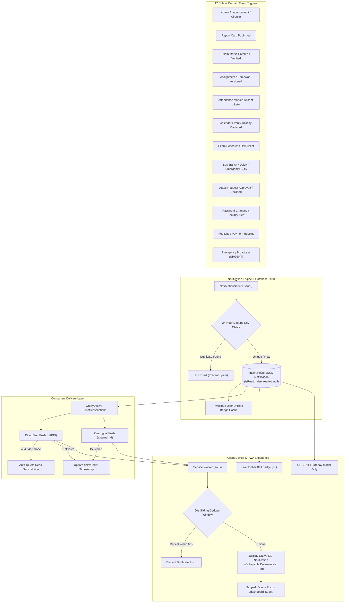

# SRT Portal Notification System Architecture

Date: November 22, 2026  
Status: Active & Live  
Platforms Supported: Android PWA / Capacitor, iOS Safari PWA / APNs, Desktop Browsers (Chrome, Edge, Firefox, Safari)

---

## 1. Architecture Overview

The SRT Universal School notification engine provides a guaranteed, single-source-of-truth notification pipeline across Web Push (VAPID), OneSignal REST API, and native in-app state.



---

## 2. API Endpoints Reference

### 2.1 Notifications API

#### `GET /api/notifications`
Returns paginated notifications for the authenticated user.
- **Query Parameters**:
  - `page`: Page number (default: 1)
  - `limit`: Number of items per page (default: 20, max: 100)
  - `unreadOnly`: Boolean flag (`true` to return only unread notifications)
  - `type`: Optional filter (e.g. `ANNOUNCEMENT`, `ATTENDANCE`, `HOMEWORK`, `REPORT_CARD`, `BUS`)
  - `category`: Optional category filter
- **Response**:
```json
{
  "success": true,
  "items": [
    {
      "id": "cm3...",
      "userId": "usr_123",
      "title": "📚 New Homework: Mathematics Chapter 4",
      "content": "Exercises 4.1 to 4.3 due tomorrow.",
      "type": "HOMEWORK",
      "category": "ACADEMIC",
      "priority": "HIGH",
      "link": "/dashboard/parent/assignments",
      "isRead": false,
      "readAt": null,
      "deliveredAt": "2026-11-22T17:40:00.000Z",
      "dedupeKey": "homework-asg_789",
      "createdAt": "2026-11-22T17:40:00.000Z"
    }
  ],
  "total": 45,
  "unreadCount": 3,
  "page": 1,
  "limit": 20,
  "totalPages": 3,
  "hasMore": true
}
```

#### `GET /api/notifications/unread-count`
Returns the total unread badge count for the authenticated user.
- **Response**:
```json
{
  "success": true,
  "unreadCount": 3,
  "notificationCount": 2,
  "messageCount": 1,
  "hasBusAlert": false,
  "busAlertCount": 0
}
```

#### `PATCH /api/notifications/:id/read`
Marks an individual notification as read.
- **Response**:
```json
{
  "success": true,
  "notification": {
    "id": "cm3...",
    "isRead": true,
    "readAt": "2026-11-22T17:42:10.000Z"
  }
}
```

#### `PATCH /api/notifications/read-all`
Marks all unread notifications for the user as read.
- **Response**:
```json
{
  "success": true,
  "updatedCount": 3,
  "readAt": "2026-11-22T17:42:15.000Z"
}
```

#### `DELETE /api/notifications/:id`
Deletes a notification owned by the authenticated user.
- **Response**:
```json
{
  "success": true,
  "deletedId": "cm3..."
}
```

---

### 2.2 Push Subscription API

#### `POST /api/push/subscribe`
Registers or updates a device's Web Push subscription.
- **Request Body**:
```json
{
  "endpoint": "https://fcm.googleapis.com/fcm/send/...",
  "keys": {
    "p256dh": "BNc...",
    "auth": "A8j..."
  },
  "userAgent": "Mozilla/5.0 ...",
  "deviceName": "Android Chrome PWA",
  "platform": "ANDROID"
}
```
- **Response**:
```json
{
  "success": true,
  "subscriptionId": "sub_456",
  "associatedUser": true,
  "platform": "ANDROID"
}
```

#### `POST /api/push/unsubscribe`
Deactivates a device's push subscription.
- **Request Body**:
```json
{
  "endpoint": "https://fcm.googleapis.com/fcm/send/..."
}
```
- **Response**:
```json
{
  "success": true,
  "unsubscribedEndpoint": "https://fcm.googleapis.com/fcm/send/..."
}
```

---

### 2.3 Notification Preferences API

#### `GET /api/notification-preferences`
Retrieves user category preferences.
- **Response**:
```json
{
  "success": true,
  "preferences": {
    "enabled": true,
    "general": true,
    "account": true,
    "alerts": true,
    "academic": true,
    "admin": true,
    "maintenance": true
  },
  "devices": [
    {
      "id": "sub_456",
      "deviceName": "Android Chrome PWA",
      "platform": "ANDROID",
      "createdAt": "2026-11-20T10:00:00.000Z",
      "lastUsedAt": "2026-11-22T17:40:00.000Z"
    }
  ]
}
```

#### `PUT /api/notification-preferences`
Updates user category preferences.
- **Request Body**:
```json
{
  "alerts": true,
  "academic": true,
  "general": false
}
```

---

## 3. VAPID Key Generation & Setup

To generate new VAPID keys if ever rotating production credentials:

```bash
npx web-push generate-vapid-keys
```

Add the generated keys to your `.env` and AWS Amplify Environment Variables:
```env
# Web Push VAPID Configuration
VAPID_PUBLIC_KEY=BBIHzbc-DVhlpPB_plCE0gUMpCSsHiqA1Y5FVyP-ax6p0HWnFZILFISth4FYfyAp0gywswCBxz4GfDnXm_c-Agk
NEXT_PUBLIC_VAPID_PUBLIC_KEY=BBIHzbc-DVhlpPB_plCE0gUMpCSsHiqA1Y5FVyP-ax6p0HWnFZILFISth4FYfyAp0gywswCBxz4GfDnXm_c-Agk
VAPID_PRIVATE_KEY=<your-secret-vapid-private-key>
VAPID_SUBJECT=mailto:admin@nipoportal.com
```

---

## 4. End-to-End Testing Procedure

### Manual Verification
1. Log in to the portal as Admin or Teacher on a mobile phone or desktop browser.
2. Grant notification permission when prompted.
3. Open another browser / tab and perform a domain action (e.g. mark attendance absent for a student).
4. Verify that the parent device receives a single notification with the collapsible tag `att-<studentId>-<date>-<session>`.
5. Tapping the notification opens the PWA directly to `/dashboard/parent/attendance` without `ERR_FAILED` or blank screens.
6. Check that the bell icon in the topbar shows an updated unread badge, and disappears when marked as read.

### Automated Test Suite
Run the notification verification suite:
```bash
npm test tests/verify-unified-notifications.test.ts
npm test tests/verify-onesignal-web-push.test.ts
```
